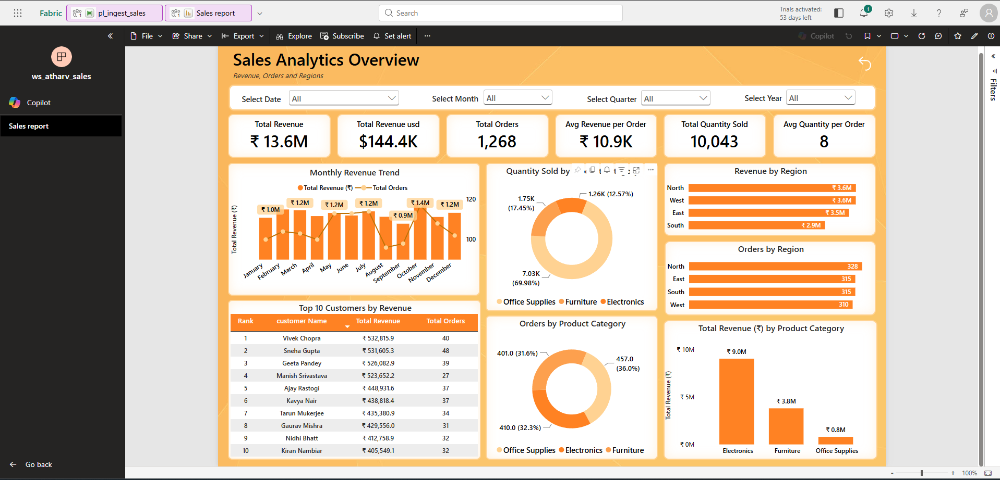
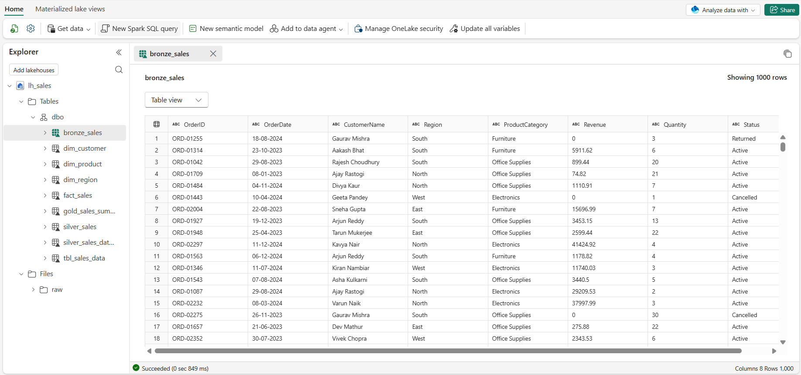
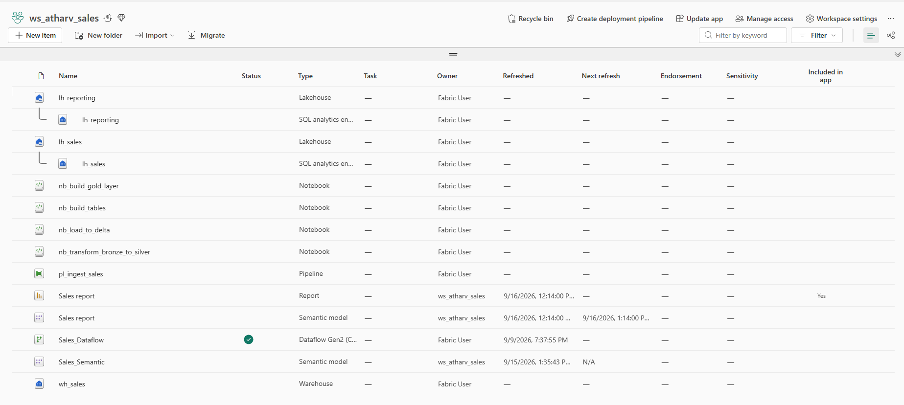
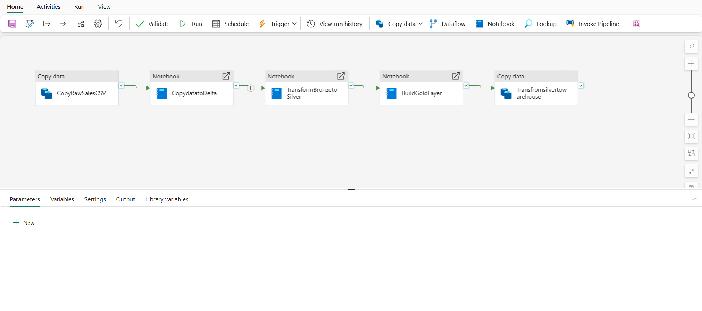
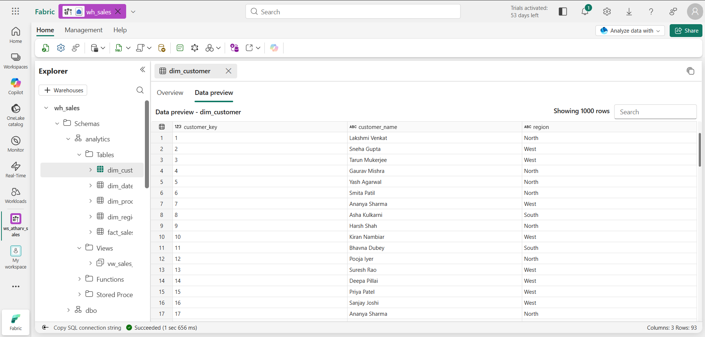

# Sales Analytics on Microsoft Fabric: Medallion Pipeline and Star Schema

This project takes a raw sales CSV through a Bronze, Silver and Gold pipeline in a Fabric Lakehouse, models it as a star schema in a Fabric Warehouse, and reports on it in Power BI. I built it to learn how ingestion, modeling and reporting connect on one platform.

The source file has 1,525 order rows from January 2023 to December 2024. After cleaning, 1,268 rows reach the report.



## Contents

- [Architecture](#architecture)
- [Tech stack](#tech-stack)
- [Dataset](#dataset)
- [Repository structure](#repository-structure)
- [Fabric workspace items](#fabric-workspace-items)
- [Build order](#build-order)
- [Report](#report)
- [Findings](#findings)
- [Known limitations](#known-limitations)
- [How to reproduce](#how-to-reproduce)
- [What I learned](#what-i-learned)
- [Contact](#contact)

## Architecture

```
sales_data.csv
      |
      |  pipeline: Copy data
      v
Lakehouse lh_sales
  Files/raw --> bronze_sales --> silver_sales --> Gold sales summary
                                     |
                                     |--> nb_build_tables --> dim_customer, dim_product,
                                     |                        dim_region, fact_sales
                                     |
                                     |  pipeline: Copy data
                                     v
Warehouse wh_sales
  staging.silver_sales
  analytics.dim_date                    generated with GENERATE_SERIES
  analytics.dim_customer, dim_product,
  dim_region, fact_sales                promoted with CREATE TABLE AS SELECT
      |
      v
Semantic model Sales_Semantic --> Power BI report "Sales report"
```

The pipeline `pl_ingest_sales` covers ingestion, Bronze, Silver and the Gold summary, and finishes by copying `silver_sales` into the Warehouse. The star schema tables are built afterwards with a notebook and moved into the Warehouse with SQL. The semantic model and the report read from the Warehouse tables.

## Tech stack

| Area | Tools |
|---|---|
| Platform | Microsoft Fabric: Lakehouse, Warehouse, Data Factory pipeline, Dataflow Gen2, notebooks, semantic model |
| Processing | PySpark, Delta tables |
| SQL | T-SQL: schemas, a view, a stored procedure, `GENERATE_SERIES`, `CREATE TABLE AS SELECT` |
| Modeling | Star schema with surrogate keys and a generated date dimension |
| Reporting | Power BI |

## Dataset

The source is `sales_data.csv`, included in this repository.

| Detail | Value |
|---|---|
| Rows | 1,525 |
| Columns | OrderID, OrderDate, CustomerName, Region, ProductCategory, Revenue, Quantity, Status |
| Period | 2 January 2023 to 30 December 2024 |
| Status | Active 1,273, Cancelled 161, Returned 91 |
| Regions | North, South, East, West |
| Categories | Electronics, Furniture, Office Supplies |
| Customer names | 40 distinct names |

The Silver layer keeps Active orders with revenue above zero. That leaves 1,268 rows: the 161 Cancelled orders, 91 Returned orders and 5 Active orders with zero revenue are dropped. Silver also adds a `revenue_usd` column.



## Repository structure

```
Sales-Analytics-Microsoft-Fabric-Pipeline/
├── notebooks/
│   ├── nb_load_to_delta.ipynb
│   ├── nb_transform_bronze_to_silver.ipynb
│   ├── nb_build_gold_layer.ipynb
│   └── nb_build_tables.ipynb
├── sql/
│   └── warehouse_setup.sql
├── screenshots/
│   ├── 01_workspace_overview.png
│   ├── 02_pipeline_flow.png
│   ├── 03_lakehouse_tables.png
│   ├── 04_warehouse_tables.png
│   └── 05_powerbi_report.png
├── Sales_report.pbix
├── sales_data.csv
└── README.md
```

## Fabric workspace items

| Item | Type | Purpose |
|---|---|---|
| `lh_sales` | Lakehouse | Bronze, Silver and Gold Delta tables, plus the star schema tables |
| `lh_reporting` | Lakehouse | Supporting Lakehouse for reporting |
| `nb_load_to_delta` | Notebook | Loads the raw CSV into the Bronze Delta table |
| `nb_transform_bronze_to_silver` | Notebook | Cleans Bronze into `silver_sales` |
| `nb_build_gold_layer` | Notebook | Builds the Gold sales summary table |
| `nb_build_tables` | Notebook | Builds `dim_customer`, `dim_product`, `dim_region` and `fact_sales` from `silver_sales` |
| `pl_ingest_sales` | Data pipeline | Runs ingestion, Bronze, Silver, Gold and the copy into the Warehouse |
| `Sales_Dataflow` | Dataflow Gen2 | Extra data preparation |
| `wh_sales` | Warehouse | Holds `staging.silver_sales` and the `analytics` star schema |
| `Sales_Semantic` | Semantic model | Data model behind the report |
| `Sales report` | Power BI report | The dashboard |



## Build order

I ran the work in five stages. The pipeline automates the first one. I ran stages 2 to 4 by hand.

### 1. Ingestion pipeline



| Order | Activity | What it does |
|---|---|---|
| 1 | Copy data | Copies `sales_data.csv` into the Lakehouse (`Files/raw`) |
| 2 | Notebook `nb_load_to_delta` | Loads the CSV into the Bronze Delta table |
| 3 | Notebook `nb_transform_bronze_to_silver` | Builds `silver_sales`: Active orders with revenue above zero, 1,268 of 1,525 rows, plus `revenue_usd` |
| 4 | Notebook `nb_build_gold_layer` | Builds the Gold sales summary table |
| 5 | Copy data | Copies `silver_sales` from the Lakehouse into the Warehouse |

### 2. Warehouse setup

In a query window on `wh_sales`, I created three schemas. `staging` holds data copied from the Lakehouse and `analytics` holds modeled tables and views. `reporting` was created for report-facing objects but is not used yet.

```sql
CREATE SCHEMA staging;
CREATE SCHEMA analytics;
CREATE SCHEMA reporting;
```

I checked the copied data with a `TOP 5` query and a revenue-by-region summary (both are in `sql/warehouse_setup.sql`). Then I created the view `analytics.vw_sales_by_region`, which gives revenue, order count and average order value by region and month, and a stored procedure that returns the top N customers by revenue:

```sql
CREATE PROCEDURE analytics.usp_GetTopCustomers
    @TopN INT = 10
AS
BEGIN
    SELECT TOP (@TopN)
        customer_name,
        SUM(revenue) AS total_revenue,
        COUNT(order_id) AS total_orders
    FROM staging.silver_sales
    GROUP BY customer_name
    ORDER BY total_revenue DESC;
END;

EXEC analytics.usp_GetTopCustomers;            -- top 10
EXEC analytics.usp_GetTopCustomers @TopN = 5;  -- top 5
```

The last piece is `analytics.dim_date`. It is generated with `GENERATE_SERIES` and covers every day from 1 January 2023 to 31 December 2024 (731 days), including days with no sales.

```sql
CREATE TABLE analytics.dim_date (
    order_date_key INT         NOT NULL,  -- YYYYMMDD
    full_date      DATE        NOT NULL,
    year           INT         NOT NULL,
    month_number   INT         NOT NULL,
    month_name     VARCHAR(20) NOT NULL,
    quarter        INT         NOT NULL,
    day_of_week    VARCHAR(20) NOT NULL,
    is_weekend     BIT         NOT NULL
);

INSERT INTO analytics.dim_date
SELECT
    CAST(FORMAT(dt, 'yyyyMMdd') AS INT) AS order_date_key,
    dt                                  AS full_date,
    YEAR(dt)                            AS year,
    MONTH(dt)                           AS month_number,
    DATENAME(MONTH, dt)                 AS month_name,
    DATEPART(QUARTER, dt)               AS quarter,
    DATENAME(WEEKDAY, dt)               AS day_of_week,
    CASE WHEN DATEPART(WEEKDAY, dt) IN (1, 7) THEN 1 ELSE 0 END AS is_weekend
FROM (
    SELECT DATEADD(DAY, CAST(value AS INT), CAST('2023-01-01' AS DATE)) AS dt
    FROM GENERATE_SERIES(0, 730)
) AS dates;
```

### 3. Star schema in the Lakehouse

`nb_build_tables` reads `silver_sales` (1,268 rows) and writes four Delta tables. Surrogate keys come from `monotonically_increasing_id()`.

In the raw file, 34 of the 40 customer names appear in more than one region. For that reason `dim_customer` is built from distinct name and region pairs, which gives 93 rows. `dim_product` has 3 rows and `dim_region` has 4.

```python
dim_customer = df.select('customer_name', 'region') \
    .distinct() \
    .withColumn('customer_key', monotonically_increasing_id() + 1)

dim_customer = dim_customer.select('customer_key', 'customer_name', 'region')
dim_customer.write.format('delta').mode('overwrite').saveAsTable('dim_customer')
```

`fact_sales` joins `silver_sales` back to each dimension to pick up the keys. The date key uses the same `YYYYMMDD` format as `dim_date`.

```python
fact = df_silver \
    .join(df_customer,
        (df_silver.customer_name == df_customer.customer_name) &
        (df_silver.region == df_customer.region),
        'left') \
    .join(df_product,
        df_silver.product_category == df_product.product_category,
        'left') \
    .join(df_region,
        df_silver.region == df_region.region,
        'left')

fact = fact.withColumn(
    'order_date_key',
    date_format(to_date(col('order_date'), 'yyyy-MM-dd'), 'yyyyMMdd').cast('int')
)

fact_sales = fact.select(
    col('order_id'), col('order_date_key'), col('customer_key'),
    col('product_key'), col('region_key'),
    col('revenue'), col('quantity'), col('revenue_usd')
)
fact_sales.write.format('delta').mode('overwrite').saveAsTable('fact_sales')
```

`fact_sales` has 1,268 rows, each with integer keys for customer, product, region and date.

### 4. Promotion into the Warehouse

Four `CREATE TABLE AS SELECT` statements copy the dimension and fact tables from the Lakehouse into the `analytics` schema, next to `dim_date`.

```sql
CREATE TABLE analytics.dim_customer AS SELECT * FROM lh_sales.dbo.dim_customer;
CREATE TABLE analytics.dim_product  AS SELECT * FROM lh_sales.dbo.dim_product;
CREATE TABLE analytics.dim_region   AS SELECT * FROM lh_sales.dbo.dim_region;
CREATE TABLE analytics.fact_sales   AS SELECT * FROM lh_sales.dbo.fact_sales;
```



### 5. Semantic model and report

`Sales_Semantic` is built on the `analytics` tables, and `Sales report` reads from it.

## Report

The report has one page, with slicers for date, month, quarter and year.

- Six KPI cards: Total Revenue (INR), Total Revenue (USD), Total Orders, Average Revenue per Order, Total Quantity Sold and Average Quantity per Order
- A monthly revenue trend with order counts
- Quantity sold and orders by product category (two donut charts)
- Revenue by region, orders by region and revenue by product category
- A Top 10 customers table with revenue and order counts

## Findings

1. The report shows ₹13.6M in revenue ($144.4K in USD) from 1,268 order rows and 10,043 units.
2. Electronics brings in ₹9.0M, about two thirds of revenue. Furniture adds ₹3.8M and Office Supplies ₹0.8M, about 6%.
3. Office Supplies has the most orders (36.0%, against 32.3% for Electronics and 31.6% for Furniture) and about 70% of units sold (7.03K of 10,043), but its revenue is the smallest.
4. North and West each bring in ₹3.6M, East ₹3.5M and South ₹2.9M. East and South both have 315 orders, so South's orders are worth less on average.
5. The top 10 customers by name account for about ₹4.7M, roughly a third of revenue. Vivek Chopra is first with ₹532.8K from 40 orders, and Kiran Nambiar is tenth with ₹405.5K from 32.
6. Revenue rose from ₹6.1M in 2023 to ₹7.5M in 2024, an increase of about 22%. Across calendar months, September is the lowest at ₹0.9M and October the highest at ₹1.4M.

## Known limitations

- The raw file contains 20 exact duplicate rows, 18 of them Active orders. Those 18 are still in `silver_sales`, so Total Orders (1,268) counts rows while the data has 1,250 distinct order IDs. Without them, revenue would be about ₹13.47M instead of ₹13.64M.
- `nb_build_tables` and the promotion statements run outside the pipeline, so a full refresh needs them to be run by hand. `CREATE TABLE AS SELECT` fails if the target table already exists, so the `analytics` tables have to be dropped before promoting again.
- The Top 10 customers table groups by customer name, so a name that appears in several regions counts as one customer there, while `dim_customer` keeps each name and region pair separate.

## How to reproduce

1. Create a Microsoft Fabric workspace. The free trial is enough.
2. Create a Lakehouse named `lh_sales` and a Warehouse named `wh_sales`.
3. Upload `sales_data.csv` to `Files/raw` in `lh_sales`.
4. Import the four notebooks from `notebooks/`, create the pipeline `pl_ingest_sales` with the five activities listed above, and run it. This produces the Bronze, Silver and Gold tables and copies `silver_sales` into the Warehouse.
5. In `wh_sales`, run `sql/warehouse_setup.sql` down to and including the `dim_date` insert.
6. Run `notebooks/nb_build_tables.ipynb` against `lh_sales`.
7. In `wh_sales`, run the four `CREATE TABLE AS SELECT` statements at the end of `sql/warehouse_setup.sql`.
8. Create the semantic model on the `analytics` tables, then open `Sales_report.pbix` in Power BI Desktop or build a new report on the model.

## What I learned

- Keeping Bronze, Silver and Gold as separate tables let me check each stage before running the next one.
- Customer names repeat across regions, so `dim_customer` needed name and region together as its key. Joining facts on name alone would have multiplied fact rows.
- Separate `staging` and `analytics` schemas keep copied data apart from modeled tables, which makes it clear which tables are safe to report on.
- Building `dim_date` in the Warehouse before the fact table gave every date in the range a row, including days with no sales, so the date keys in `fact_sales` already had something to point to.
- The Lakehouse suited the Spark transformations and the Warehouse suited the T-SQL modeling. Moving the finished star schema across took one `CREATE TABLE AS SELECT` per table.

## Contact

Atharv Dhole

- LinkedIn: https://www.linkedin.com/in/atharv-dhole/
- Email: atharvdhole22@gmail.com
